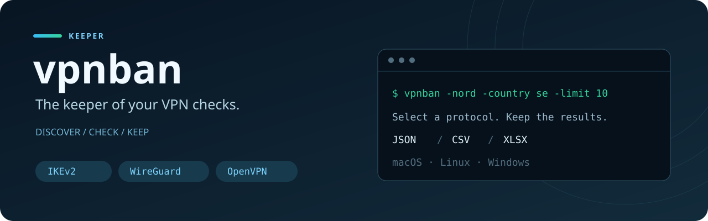

<div align="center">



# vpnban · بان

**نگهبان بررسی‌های VPN. پروتکل را انتخاب کنید و نتیجه را به خاطر بسپارید.**

[English](README.md) · [فارسی](README.fa.md)

[](https://github.com/WhoisGray/vpnban/actions/workflows/ci.yml)
[](https://github.com/WhoisGray/vpnban/releases/latest)
[](#مشارکت)

</div>

---

**vpnban** (بان، «نگهبان») ابزار خط فرمان Go است که سرورها و نتیجه‌های بررسی را به خاطر می‌سپارد. فهرست سرورها را از API رسمی NordVPN می‌گیرد یا فهرست دامنه و IPv4 شما را می‌خواند و نتیجه را در JSON، CSV و Excel نگه می‌دارد.

> نتیجهٔ بررسی، وضعیت پاسخ‌گویی از شبکهٔ فعلی شماست و ورود موفق، ساخت تونل یا سرعت اینترنت را تضمین نمی‌کند. فقط سرورهایی را بررسی کنید که اجازهٔ آزمایششان را دارید.

## چرا بان؟

- **برنامهٔ پنجره‌ای دسکتاپ و رابط وب:** برنامهٔ بومی چندسکویی (macOS، Linux، Windows) بر پایهٔ طراحی Stitch با نقشهٔ سایبرپانک جهانی، ماتریس سلامت سرورها، تله‌متری زنده و مدیریت فهرست شخصی. اجرا از طریق پنجره دسکتاپ یا دستور `vpnban -gui`.
- انتخاب IKEv2، WireGuard، OpenVPN یا ترکیبی از آن‌ها در حالت NordVPN.
- فیلتر کشور و بار سرور و محدود کردن تعداد بررسی‌ها.
- پشتیبانی از فهرست شخصی و نتیجه‌های ذخیره‌شده.
- خروجی قابل استفاده برای تحلیل و اشتراک‌گذاری.
- بسته‌های macOS، Linux و Windows برای amd64 و arm64.

## شروع سریع

پس از نصب، بررسی را از طریق محیط گرافیکی یا خط فرمان انجام دهید:

```bash
vpnban -version
vpnban -gui                              # اجرای رابط گرافیکی پنجره‌ای / وب
vpnban -nord -country se -limit 10
```

### برنامهٔ دسکتاپ (macOS · Linux · Windows)

می‌توانید محیط کاربری Stitch را مستقیماً از طریق خط فرمان باز کنید یا نسخهٔ دسکتاپ اختصاصی را اجرا نمایید:

- **از طریق ترمینال:** دستور `vpnban -gui` (آدرس `http://127.0.0.1:8329` را در مرورگر یا پنجرهٔ پیش‌فرض باز می‌کند).
- **برنامهٔ مستقل:** دانلود یا بیلد بستهٔ دسکتاپ (`vpnban.app` در مک، `vpnban.exe` در ویندوز، و فایل باینری در لینوکس):
  ```bash
  cd desktop
  wails build
  ```

این دستور IKEv2 را روی حداکثر ده سرور سوئد بررسی می‌کند. در PowerShell، اگر فایل در پوشهٔ فعلی است، از `.\vpnban.exe` استفاده کنید.

## دانلود

آخرین نسخه را با یک دستور نصب کنید. دستور خودش سیستم و معماری را می‌فهمد و همان بسته را با چک‌سام SHA256 می‌گذارد روی PATH.

macOS و Linux. همین یک خط نصب می‌کند، و با `-update` همان خط را برای آخرین نسخه دوباره می‌زند:

```bash
curl -fsSL https://raw.githubusercontent.com/WhoisGray/vpnban/refs/heads/main/install.sh | sh -s -- -update
```

Windows در PowerShell. دوباره اجرا کردنش یعنی به‌روزرسانی:

```powershell
irm https://raw.githubusercontent.com/WhoisGray/vpnban/refs/heads/main/install.ps1 | iex
```

برای به‌روزرسانی نسخه‌های دارای پرچم `-update`، روی هر سه سیستم:

```bash
vpnban -update
```

نسخهٔ قدیمی `v1.0.1` پرچم `-update` را ندارد. برای این نسخه، همان دستور نصب را دوباره اجرا کنید.

فایل هر سیستم از [Releases](https://github.com/whoisGray/vpnban/releases) هم جداگانه هست. با پوش کردن یک تگ مثل `v1.1.0` ساخته می‌شود. کنار فایل‌ها `checksums.txt` هست.

| سیستم | معماری | فایل |
| --- | --- | --- |
| macOS اپل سیلیکون | arm64 | `vpnban_1.1.0_darwin_arm64.tar.gz` |
| macOS اینتل | amd64 | `vpnban_1.1.0_darwin_amd64.tar.gz` |
| Linux | amd64 | `vpnban_1.1.0_linux_amd64.tar.gz` |
| Linux | arm64 | `vpnban_1.1.0_linux_arm64.tar.gz` |
| Windows | amd64 | `vpnban_1.1.0_windows_amd64.zip` |
| Windows | arm64 | `vpnban_1.1.0_windows_arm64.zip` |

`1.1.0` همان شمارهٔ تگ است، بدون `v`.

### macOS و Linux

```bash
tar -xzf vpnban_1.1.0_darwin_arm64.tar.gz
sudo mv vpnban /usr/local/bin/
vpnban -version
```

بایینری امضا نشده است. اگر Gatekeeper روی مک جلوی اجرا را گرفت:

```bash
xattr -d com.apple.quarantine /usr/local/bin/vpnban
```

جمع چک:

```bash
shasum -a 256 -c checksums.txt
```

روی Linux به جای `shasum` از `sha256sum -c checksums.txt` استفاده کنید.

### Windows

zip را باز کنید و در PowerShell:

```powershell
.\vpnban.exe -version
Get-FileHash .\vpnban_1.1.0_windows_amd64.zip -Algorithm SHA256
```

هش را با خط همان فایل در `checksums.txt` مقایسه کنید.

### نصب با Go

Go 1.22 یا جدیدتر:

```bash
go install github.com/whoisGray/vpnban@latest
```

## استفاده

```bash
vpnban -nord                         # فقط IKEv2
vpnban -nord -proto wire             # فقط WireGuard
vpnban -nord -proto ikev2,wire
vpnban -nord -proto full             # همه‌ی پروتکل‌ها
vpnban -nord -country se -limit 40 -c 64
vpnban -file servers.json
vpnban -file server.txt              # هر خط یک دامنه یا IPv4
```

`-proto` این‌ها را می‌پذیرد: `ikev2`، `wire` (همان `wg` و `wireguard`)، `openvpn`، فهرست با ویرگول، یا `full`.

`full` علاوه بر WireGuard و OpenVPN و IKEv2، پورت‌های udp/53 و tcp/80 را هم چک می‌کند تا پاسخ عجیب فایروال در جدول بیاید. اسکن تک‌پروتکل این دو پورت اضافه را نمی‌زند.

سروری که پروتکل انتخاب‌شده را ندارد از فهرست حذف می‌شود.

خروجی Nord این سه فایل است:

- `nord-results.json`
- `nord-results.csv`
- `nord-results.xlsx`

حالت فایل، خروجی را در `vpnban-results.json` و `vpnban-results.csv` و `vpnban-results.xlsx` می‌نویسد.

کش فهرست Nord در `~/.cache/nordike` است و ۶ ساعت می‌ماند. `-refresh` کش را دور می‌زند.

اگر VPN روشن باشد و DNS فقط آدرس خصوصی (مثل `10.10`) برگرداند، فاز کشف متوقف می‌شود. VPN را خاموش کنید، یا با `-allow-poisoned` ادامه دهید.

### معنی چند ستون

| مقدار | معنی |
| --- | --- |
| `real` | پاسخ شبیه سرور واقعی همان پروتکل بود |
| `p1` | فقط فاز اول IKEv2 جواب داد |
| `silent` | پاسخی نیامد |
| `fresh=yes` | شواهد پروتکل پذیرفته شد؛ پاسخ فقط فاز اول IKEv2 هم ممکن است کافی باشد |
| `unproven` | جواب قابل اتکا نبود |

## پرچم‌ها

| پرچم | پیش‌فرض | کار |
| --- | --- | --- |
| `-gui` | خاموش | اجرای محیط گرافیکی و پنجره‌ای دسکتاپ / وب |
| `-port` | `8329` | پورت سرور وب محلی رابط کاربری |
| `-nord` | خاموش | گرفتن فهرست NordVPN و آزمایش |
| `-proto` | `ikev2` | پروتکل آزمایش |
| `-country` | همه | کد یا نام کشور، با ویرگول |
| `-limit` | `0` | سقف تعداد؛ صفر یعنی همه. کم‌بارترین‌ها اول |
| `-load` | `100` | رد کردن سرور شلوغ‌تر از این |
| `-offline` | خاموش | سرورهای غیرآنلاین هم بیایند |
| `-refresh` | خاموش | دانلود دوبارهٔ فهرست |
| `-ttl` | `6h` | عمر کش |
| `-c` | `80` | تعداد کار همزمان. در `-nord` اگر این را ندهید ۳۲ است |
| `-ike-timeout` | `1s` | مهلت IKEv2 |
| `-tcp-timeout` | `1200ms` | مهلت TCP. در `-nord` اگر ندهید `1s` است |
| `-ike-user` | بسته به حالت | هویت کاربر در IKE_AUTH |
| `-ike-id` | بسته به حالت | شناسهٔ سمت سرور در IKE_AUTH |
| `-file` | | JSON کاتالوگ، فایل متنی، یا نتیجهٔ قبلی |
| `-phase` | | `1` کشف DNS، `2` آزمایش، `all` هر دو |
| `-dns` | `1.1.1.1:53` | سرور DNS فاز کشف |
| `-allow-poisoned` | خاموش | ادامه با وجود IP خصوصی |
| `-json` `-csv` `-xlsx` | بسته به حالت | مسیر خروجی |
| `-version` | | چاپ نسخه و خروج |
| `-update` | | جایگزینی همین برنامه با آخرین Release گیت‌هاب |

در `-nord` اگر `-ike-user` و `-ike-id` را ندهید، مقدارشان `health@nordvpn.com` و `nordvpn.com` است. در حالت فایل، `this is health check` و `ironnodes.com`.

## انتشار

```bash
git tag v1.0.0
git push origin v1.0.0
```

workflow به نام Release اول تست را اجرا می‌کند، بعد شش بسته را می‌سازد و روی صفحهٔ Releases می‌گذارد. `vpnban -version` همان تگ را چاپ می‌کند.

هر push و هر pull request هم با workflow به نام CI تست و کامپایل هر شش سیستم را می‌گیرد.

## ساخت محلی

```bash
go test ./...
go build -o vpnban .
./vpnban -version
```


## نکته‌های مهم

پرچم `-proto` مخصوص حالت NordVPN است و روند بررسی فایل شخصی را تغییر نمی‌دهد. نتیجهٔ `silent` می‌تواند ناشی از فیلتر، قطعی مسیر یا کندی باشد؛ آن را تشخیص قطعی خرابی سرور ندانید.

نصاب‌ها معماری و سیستم را تشخیص می‌دهند و چک‌سام آرشیو را بررسی می‌کنند. می‌توانید پیش از اجرا، [نصاب Unix](install.sh) و [نصاب Windows](install.ps1) را بخوانید. اگر مسیر نصب روی `PATH` نبود، دستور چاپ‌شده توسط نصاب را اجرا کنید.

## نقشهٔ راه ارائه‌دهندگان

**در حال حاضر فقط NordVPN کشف خودکار داخلی دارد.** حالت فایل شخصی جداگانه در دسترس است. موارد زیر ایده‌های مشارکت هستند و هنوز پیاده‌سازی نشده‌اند.

- [x] NordVPN: دریافت از API رسمی، فیلتر، کش و بررسی پروتکل‌ها.
- [x] فهرست دامنه و IPv4 شخصی و ورودی JSON پشتیبانی‌شده.
- [ ] VPN Unlimited: بررسی منبع رسمی یا مستند فهرست سرورها و پروتکل‌ها.
- [ ] Windscribe: بررسی کشف سرورها، نیاز به حساب و اطلاعات پروتکل.
- [ ] VyprVPN: بررسی منبع سرورها و پوشش پروتکل‌ها.
- [ ] Proton VPN: بررسی کاتالوگ مستند یا ورود تنظیمات.
- [ ] Mullvad: بررسی فهرست relay و اطلاعات پروتکل.
- [ ] Surfshark: بررسی منبع مستند یا ورود تنظیمات.
- [ ] رابط مشترک ارائه‌دهندگان برای جداسازی کشف، اطلاعات، کش و بررسی.
- [ ] تست با دادهٔ نمونه برای تجزیهٔ پاسخ، خطا و پروتکل پشتیبانی‌نشده.
- [ ] مستندات راه‌اندازی، محدودیت‌ها و نمونه‌ها به انگلیسی و فارسی.

ارائه‌دهندهٔ دیگری مدنظر دارید؟ [درخواست اضافه‌کردن ارائه‌دهنده](https://github.com/WhoisGray/vpnban/issues/new?title=Provider%20request%3A%20) را با نام سرویس، منبع مستند سرورها، پروتکل‌ها و نیاز به حساب ثبت کنید.

## مشارکت

برای اضافه‌کردن ارائه‌دهندگان، کدنویسی Go، تست، ترجمه و گزارش خطای قابل بازتولید کمک کنید.

1. یک Issue باز کنید یا کار موجودی را انتخاب کنید و محدودهٔ کارتان را توضیح دهید.
2. مخزن را Fork کنید و یک شاخهٔ مشخص بسازید.
3. برای ارائه‌دهندهٔ جدید، منبع سرورها، احراز هویت، محدودیت درخواست و پروتکل‌ها را مستند کنید. رمز، توکن و کلید خصوصی را در مخزن قرار ندهید.
4. تست تجزیهٔ پاسخ با دادهٔ نمونه و حالت‌های خطا اضافه کنید. از کد بررسی فعلی استفاده کنید و پروتکل‌های پشتیبانی‌نشده را واضح مشخص کنید.
5. هر دو README را به‌روز کنید، `go test ./...` و `go build -o vpnban .` را اجرا کنید و Pull Request را با نمونهٔ خروجی و نتیجهٔ بررسی‌ها بفرستید.

نقطه‌های شروع: [nord.go](nord.go) برای کشف و فیلتر، [main.go](main.go) برای خط فرمان و ورودی، و [ike.go](ike.go)، [wg.go](wg.go)، [ovpn.go](ovpn.go) برای بررسی پروتکل‌ها. رابط مشترک ارائه‌دهندگان هنوز جزو نقشهٔ راه است.

---

اگر بان برایتان مفید بود، با یک **ستاره ⭐** و اشتراک تجربه‌تان از پروژه حمایت کنید.
