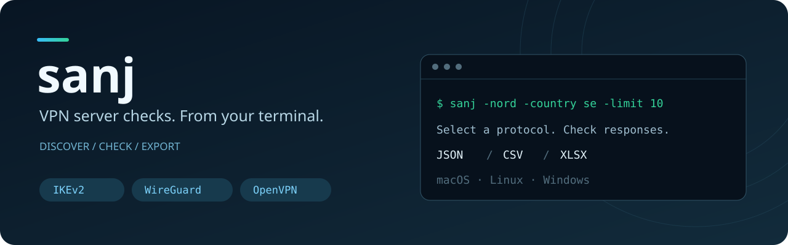

<div align="center">



# sanj · سنج

**Check VPN server responses. Choose your protocol. Keep the results.**

[English](README.md) · [فارسی](README.fa.md)

[](https://github.com/WhoisGray/sanj/actions/workflows/ci.yml)
[](https://github.com/WhoisGray/sanj/releases/latest)
[](go.mod)
[](#contribute)

[Get started](#quick-start) · [Usage](#usage) · [Provider roadmap](#provider-roadmap) · [Contribute](#contribute)

</div>

---

**sanj** is a Go command-line tool for checking VPN server responses. Discover servers through NordVPN's official API or bring your own host list, run protocol checks, and export the results as JSON, CSV, and Excel.

> Checks show what responds from your current network. They do not guarantee successful VPN login, a working tunnel, or browsing performance. Only scan servers you have permission to check.

## Why sanj?

- **Choose the checks:** IKEv2 by default; WireGuard, OpenVPN, combinations, or a full NordVPN scan.
- **Narrow the search:** filter NordVPN servers by country and load, then limit how many to check.
- **Bring your own list:** use domain/IPv4 text files, supported JSON catalogs, or previous results.
- **Keep useful reports:** JSON for automation, CSV for analysis, XLSX for sharing.
- **Run across platforms:** macOS, Linux, and Windows releases for amd64 and arm64.
- **Reuse discovery:** six-hour NordVPN cache with an explicit refresh option.

## Quick start

### 1. Install

**macOS / Linux**

```bash
curl -fsSL https://raw.githubusercontent.com/WhoisGray/sanj/refs/heads/main/install.sh | sh
```

**Windows · PowerShell**

```powershell
irm https://raw.githubusercontent.com/WhoisGray/sanj/refs/heads/main/install.ps1 | iex
```

The installers select your platform and architecture and verify the archive against the release SHA256 checksums. If the installer asks you to add a directory to `PATH`, follow its printed instruction and reopen your terminal. You can inspect [install.sh](install.sh) or [install.ps1](install.ps1) before running it.

Prefer a manual install? Download an archive and `checksums.txt` from [Releases](https://github.com/WhoisGray/sanj/releases/latest).

| System | amd64 / Intel | arm64 / Apple silicon |
| --- | --- | --- |
| macOS | `darwin_amd64.tar.gz` | `darwin_arm64.tar.gz` |
| Linux | `linux_amd64.tar.gz` | `linux_arm64.tar.gz` |
| Windows | `windows_amd64.zip` | `windows_arm64.zip` |

Archive names begin with `sanj_<version>_`. Verify the downloaded archive before extraction: use `shasum -a 256 <archive>` on macOS, `sha256sum <archive>` on Linux, or `Get-FileHash <archive> -Algorithm SHA256` in PowerShell, and compare with the matching line in `checksums.txt`. Extract the binary into a directory on your `PATH`; on Unix, make it executable with `chmod +x sanj`. macOS binaries are unsigned; if Gatekeeper blocks a verified download, remove its quarantine attribute with `xattr -d com.apple.quarantine /path/to/sanj`.

**With Go 1.22+**

```bash
go install github.com/whoisGray/sanj@latest
```

### 2. Run a focused check

```bash
sanj -version
sanj -nord -country se -limit 10
```

This checks IKEv2 on up to ten Swedish NordVPN servers. In PowerShell, use `.\sanj.exe` if the executable is in your current folder rather than on `PATH`.

### 3. Open the reports

NordVPN mode writes `nord-results.json`, `nord-results.csv`, and `nord-results.xlsx` in the current directory. Custom-file mode uses the `sanj-results` prefix. Override paths with `-json`, `-csv`, and `-xlsx`.

## Usage

### NordVPN discovery and protocol selection

```bash
sanj -nord                              # IKEv2 only
sanj -nord -proto wire                   # WireGuard only
sanj -nord -proto openvpn                # OpenVPN UDP + TCP
sanj -nord -proto ikev2,wire              # Selected protocols
sanj -nord -proto full                   # All checks + firewall diagnostics
sanj -nord -country se,de -limit 40 -c 32
sanj -nord -refresh                      # Bypass the cached server list
```

`-proto` applies to NordVPN mode. It accepts `ikev2`, `wire` (aliases: `wg`, `wireguard`), `openvpn`, comma-separated combinations, or `full`. Servers without any selected protocol are filtered out. Full mode also probes UDP/53 and TCP/80 to help identify unusual firewall responses.

### Your own server list

Create `servers.txt` with one authorized domain or IPv4 address per line. Blank lines and `#` comments are supported.

```bash
sanj -file servers.txt
sanj -file servers.json
sanj -file servers.txt -phase 1           # DNS discovery only
sanj -file sanj-results.json -phase 2     # Probe saved addresses
```

Custom-file mode uses its own discovery and probing flow; the NordVPN `-proto` selector does not configure it. See [main.go](main.go) for supported JSON catalog and saved-result formats.

### Read the results

| Value | Meaning |
| --- | --- |
| `real` | Response matched the expected protocol checks |
| `p1` | Only the first IKEv2 phase succeeded |
| `silent` | No response was received |
| `fresh=yes` | The scorer accepted protocol evidence; this can include IKEv2 phase-one-only evidence |
| `unproven` | No conclusive protocol evidence |

A silent server may be filtered, unreachable, or simply slow. Treat a result as evidence from one network at one point in time.

### Cache and DNS troubleshooting

NordVPN discovery is cached under `~/.cache/nordike` for six hours by default. Use `-refresh` to fetch again or `-ttl` to change the lifetime.

In custom-file discovery, if DNS returns only private addresses, sanj stops by default. Check your VPN and resolver settings before retrying. `-allow-poisoned` overrides this safeguard when that behavior is intentional.

## Options

| Flag | Default | Purpose |
| --- | --- | --- |
| `-nord` | `false` | Discover and check NordVPN servers |
| `-proto` | `ikev2` | NordVPN protocol selection |
| `-country` | All | Comma-separated country codes or names |
| `-limit` | `0` | NordVPN server limit; zero means all, lowest load first |
| `-load` | `100` | Maximum NordVPN server load |
| `-offline` | `false` | Include NordVPN servers not marked online |
| `-refresh` | `false` | Download the NordVPN catalog again |
| `-ttl` | `6h` | NordVPN cache lifetime |
| `-c` | `80`; NordVPN: `32` | Concurrent workers |
| `-ike-timeout` | `1s` | IKEv2 timeout |
| `-tcp-timeout` | `1200ms`; NordVPN: `1s` | TCP timeout |
| `-ike-user` | Mode-dependent | IKE_AUTH user identity |
| `-ike-id` | Mode-dependent | IKE_AUTH remote identity |
| `-file` | — | Input catalog, host list, or saved results |
| `-phase` | Automatic | `1` discovery, `2` probing, `all` both |
| `-dns` | `1.1.1.1:53` | Discovery DNS resolver |
| `-allow-poisoned` | `false` | Continue despite private DNS answers |
| `-json`, `-csv`, `-xlsx` | Mode-dependent | Report paths |
| `-version` | — | Print version and exit |
| `-update` | — | Replace this binary with the latest GitHub release |

IKE identities default to `health@nordvpn.com` / `nordvpn.com` in NordVPN mode, and `this is health check` / `ironnodes.com` in file mode.

To update, run `sanj -update`. Older binaries such as v1.0.1 do not recognize this flag; rerun the installer instead.

## Provider roadmap

**NordVPN is the only built-in discovery provider today.** Custom lists are supported separately. The items below are open contribution ideas, not implemented integrations or promised releases.

- [x] NordVPN — official API discovery, filters, cache, and protocol checks.
- [x] Custom domain / IPv4 lists and supported JSON input.
- [ ] VPN Unlimited — investigate an official or documented server source and supported protocols.
- [ ] Windscribe — investigate server discovery, account requirements, and protocol metadata.
- [ ] VyprVPN — investigate server discovery and protocol coverage.
- [ ] Proton VPN — investigate a documented catalog or configuration import.
- [ ] Mullvad — investigate relay discovery and protocol metadata.
- [ ] Surfshark — investigate a documented server source or configuration import.
- [ ] Shared provider interface — separate discovery, metadata, cache, and probing.
- [ ] Provider fixtures and tests — cover parsing, failures, and unsupported protocols.
- [ ] Provider documentation — setup, limitations, examples, and English/Persian updates.

Have another provider in mind? [Propose an integration](https://github.com/WhoisGray/sanj/issues/new?title=Provider%20request%3A%20) with the provider name, a documented server source, available protocols, and any account requirements.

## Contribute

**Help make sanj useful on more networks.** Provider research, Go code, tests, documentation, Persian translations, and reproducible bug reports are welcome.

1. Open an issue to discuss a provider or pick an existing task; mention what you plan to work on.
2. Fork the repository and create a focused branch.
3. For a provider, document the server source, authentication needs, rate limits, supported protocols, and limitations. Never commit credentials or private keys.
4. Add fixture-based parsing tests and error cases; reuse the current probe code where appropriate. Mark unsupported checks clearly.
5. Update both READMEs, run the checks below, and open a pull request with sample output and validation notes.

Useful starting points: [nord.go](nord.go) for discovery and filtering, [main.go](main.go) for CLI/input handling, and [ike.go](ike.go), [wg.go](wg.go), [ovpn.go](ovpn.go) for protocol checks. A shared provider interface is still a roadmap item.

```bash
git clone https://github.com/WhoisGray/sanj.git
cd sanj
go test ./...
go build -o sanj .
./sanj -version
```

CI tests and cross-compiles six OS/architecture targets. Version tags trigger the release workflow, which tests, packages binaries, and publishes SHA256 checksums.

---

If sanj helps you, **give it a star ⭐** and share your feedback. Every provider contribution makes the project more useful.
